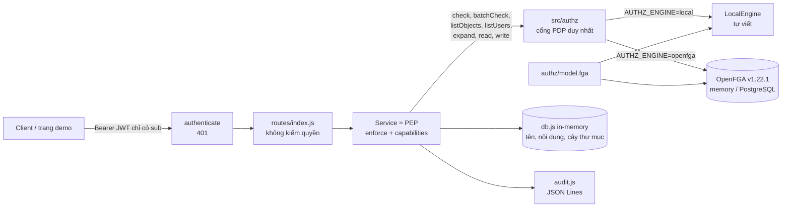

# REPORT: DocShare, phân quyền kiểu Zanzibar cho hệ thống chia sẻ tài liệu

Nhóm 07 · 23127045 · 23127102 · 23127159 · 23127183 · 23127393

Báo cáo này giải thích **các lựa chọn của nhóm dẫn tới kết quả cuối cùng**: chọn gì, không chọn gì, vì sao, và chấp nhận đánh đổi nào.

- Mọi con số đều lấy từ lượt chạy thật, lưu trong [docs/evidence/](docs/evidence/).
- Bản trình chiếu là [REPORT.html](REPORT.html), mở offline được; chế độ "Đọc tài liệu" hiện giải thích bên dưới từng slide.
- Thiết kế kỹ thuật chi tiết (thuật toán Check, dual write, consistency) nằm ở [docs/thiet-ke.md](docs/thiet-ke.md).
- Hướng dẫn triển khai nằm ở [README.md](README.md).

## Mục lục

1. [Kết quả cuối cùng](#1-kết-quả-cuối-cùng)
2. [Bài toán và phạm vi](#2-bài-toán-và-phạm-vi)
3. [Kiến trúc tổng thể](#3-kiến-trúc-tổng-thể)
4. [Các lựa chọn và lý do](#4-các-lựa-chọn-và-lý-do)
5. [Bảng tóm tắt lựa chọn](#5-bảng-tóm-tắt-lựa-chọn)
6. [Chính sách quyền (model)](#6-chính-sách-quyền-model)
7. [Kiểm thử và evidence](#7-kiểm-thử-và-evidence)
8. [Phân tích bảo mật](#8-phân-tích-bảo-mật)
9. [So sánh với Block 6 (task-api)](#9-so-sánh-với-block-6-task-api)
10. [Giới hạn và hướng phát triển](#10-giới-hạn-và-hướng-phát-triển)
11. [Câu hỏi vấn đáp](#11-câu-hỏi-vấn-đáp)
12. [Kết luận](#12-kết-luận)
13. [Phụ lục](#phụ-lục-a-thư-viện-và-phiên-bản)

## 1. Kết quả cuối cùng

| Đại lượng | Kết quả | Minh chứng |
| --- | --- | --- |
| Ma trận oracle viết tay: 8 user × 9 tài liệu, mức truy cập + quyền chia sẻ tiếp | **72/72** ô khớp trên cả LocalEngine và OpenFGA | [oracle-matrix.md](docs/oracle-matrix.md) |
| Automated test trên engine tự viết | **224/224** (7 test parity bỏ qua vì cần OpenFGA) | [tests-local.md](docs/evidence/tests-local.md) |
| Automated test trên OpenFGA v1.22.1 | **245/245**: toàn bộ test HTTP + engine test + parity | [tests-openfga.md](docs/evidence/tests-openfga.md) |
| Parity hai engine | **1.920** câu Check (960 × 2 thời điểm), ListObjects 3 type × 8 user, ListUsers 9 tài liệu, Expand 36 cây: **0 khác biệt** | [parity.test.js](test/parity.test.js) |
| Mutation test: cố ý làm sai 6 luật của model | **6/6** bị bắt (1 đến 77 test đỏ mỗi lỗi) | [mutations.md](docs/evidence/mutations.md) |
| IDOR / leo thang quyền: bỏ `enforce()` ở PEP | Trước khi sửa: **200** và test đỏ; sau khi sửa: **404 / 403**, toàn bộ test xanh | [idor.md](docs/evidence/idor.md) |
| Zanzibar lỗi hoặc mất kết nối | **500**, không trả dữ liệu (fail closed) | test P6 |
| Gỡ khỏi nhóm / gỡ chia sẻ → mất quyền sau | **0 giây**: request kế tiếp đã 404 | groups, sharing tests |
| Chia sẻ có hạn quá `expires_at` | 1 giây sau hạn: **404**, biến mất khỏi danh sách | sharing tests |
| Danh sách (ListObjects) khớp với check từng object | **8 user × (9 tài liệu + 8 thư mục)** khớp hoàn toàn | [consistency.test.js](test/consistency.test.js) |
| Đặc tả OpenAPI khớp route Express | **40/40** operation, mỗi operation có `x-relation` | test D1, D2 |
| Coverage `src/` (chạy trên OpenFGA) | **96,8% dòng**; `access.js`, `cel.js` 100% | `npm run test:coverage` |
| Triển khai | Docker compose (OpenFGA memory hoặc PostgreSQL 17), API healthy | [README §5](README.md#5-triển-khai-bằng-docker) |

### 1.1 Đối chiếu với yêu cầu nộp

Yêu cầu của đề bài và các mục "bài nộp và tự kiểm tra" của Block 6 (slide 26), kèm chỗ đáp ứng trong gói nộp:

| Yêu cầu | Đáp ứng ở đâu |
| --- | --- |
| Implement hoặc áp dụng hệ thống phân quyền Zanzibar open-source | OpenFGA v1.22.1 chạy thật ([§4.3](#43-engine-zanzibar-openfga)) và engine Zanzibar tự viết đọc cùng model ([§4.4](#44-engine-zanzibar-tự-viết-chạy-song-song)) |
| Mã nguồn | `authz/`, `src/`, `test/`, `demo/`, `scripts/` |
| Data | [`data/seed.json`](data/seed.json) và mô tả ở [`data/README.md`](data/README.md) |
| README.md hướng dẫn triển khai | [README.md](README.md): môi trường, chạy không Docker, chạy với OpenFGA, cấu hình, Docker/Postgres, demo, sự cố |
| REPORT.md: chọn X vì..., không chọn Y vì... | [§4](#4-các-lựa-chọn-và-lý-do): 21 lựa chọn, mỗi lựa chọn có **Nhóm chọn / Không chọn / Đánh đổi chấp nhận**; [§5](#5-bảng-tóm-tắt-lựa-chọn) tóm tắt |
| REPORT.html: slide kèm giải thích | [REPORT.html](REPORT.html): 36 slide, mỗi slide có lời giải thích (chế độ "Đọc tài liệu") |
| Bảng chính sách quyền, mỗi ô có test | [§6.1](#61-bảng-chính-sách-quyền): vai trò × thao tác, điều kiện, test tương ứng |
| Automated test cho request được phép và bị từ chối, một lệnh | `npm test` ([§7](#7-kiểm-thử-và-evidence)) |
| Evidence IDOR: đỏ trước khi sửa, xanh sau khi sửa | [docs/evidence/idor.md](docs/evidence/idor.md): response thật và test đỏ khi bỏ `enforce()`, xanh ở bản nộp ([§7.1](#71-evidence-idor-đỏ-trước-xanh-sau)) |
| Nơi áp dụng authorization ở server / business layer | [§4.11](#411-policy-enforcement-point-ở-service): `enforce()` trong service; diff trong idor.md |
| Giải thích chọn ACL, RBAC, ABAC hay ReBAC | [§4.2](#42-mô-hình-phân-quyền-rebac-theo-zanzibar-thay-cho-hàm-decide-viết-tay) |
| Giới hạn và trường hợp chưa kiểm tra | [§10](#10-giới-hạn-và-hướng-phát-triển), [§10.1](#101-các-trường-hợp-chưa-kiểm-tra) |
| Deny by default | [§4.21](#421-deny-by-default-và-fail-closed) |
| Câu hỏi kết thúc của Block 6 | [§11](#11-câu-hỏi-vấn-đáp) |

## 2. Bài toán và phạm vi

Ở Block 6, nhóm làm Task Management API với 2 project, 4 task và hàm `decide()` viết tay. Thầy nhận xét bài **hơi nhỏ**. Nhóm chọn một bài toán lớn hơn, đủ để dùng **đầy đủ** một hệ thống phân quyền kiểu Zanzibar. Câu hỏi kết thúc 4 của Block 6 gợi ý đúng hướng này: *"hàng triệu tài liệu chia sẻ qua nhiều nhóm thì tổ chức policy thế nào?"*

**DocShare** là API chia sẻ tài liệu kiểu Google Drive:

| Tính năng | Yêu cầu phân quyền |
| --- | --- |
| Org (tenant) và admin org | Admin quản lý mọi thứ trong org, không chạm org khác |
| Nhóm lồng nhau (`dba ⊂ backend ⊂ eng`) | Quyền cấp cho nhóm cha áp xuống member của mọi nhóm con |
| Thư mục lồng nhau | Quyền ở thư mục cha chảy xuống cả cây; chuyển thư mục thì cả cây đổi quyền |
| Chia sẻ cho user, nhóm, public link | 3 mức: viewer, commenter, editor; owner là người tạo |
| Khách ngoài org | Được sửa nếu được chia sẻ, nhưng **không** chia sẻ tiếp được |
| Chia sẻ có thời hạn | Hết hạn thì mất quyền, không cần job xóa |
| Chặn (block) | Chặn thắng mọi quyền khác, kể cả public link, và áp xuống cây con |
| Comment | Tác giả hoặc owner tài liệu xóa được, khi vẫn còn xem được tài liệu |
| "Shared with me", tìm kiếm | Chỉ trả object người gọi xem được |
| "Ai có quyền", "vì sao có quyền" | Liệt kê và giải thích, kể cả quyền gián tiếp |
| Xem trước khi chia sẻ | Biết trước kết quả mà không ghi gì |
| Nhật ký thay đổi quyền | Admin org xem các thay đổi tuple trong org |

Dữ liệu mẫu ([data/seed.json](data/seed.json), mô tả ở [data/README.md](data/README.md)):

- 2 org: `acme` cho phép chia sẻ ra ngoài, `globex` thì không;
- 8 user, 6 nhóm, 8 thư mục, 9 tài liệu, 3 comment;
- 21 tuple chia sẻ, cộng 68 tuple cấu trúc sinh tự động.

Mỗi user đại diện cho một ca biên: frank có quyền qua 3 tầng nhóm nhưng bị chặn ở handbook; gina là khách ngoài org với quyền có hạn; erin không thuộc nhóm nào.

## 3. Kiến trúc tổng thể

| Thành phần | File | Trách nhiệm |
| --- | --- | --- |
| Chính sách | `authz/model.fga` | 6 type, 1 condition; nguồn duy nhất cho cả hai engine |
| Xác thực | `src/auth.js` | Verify JWT HS256 (ghim thuật toán), nạp user theo `sub` |
| PEP | `src/services/*.js`, `access.js` | Nạp object, gọi `enforce()`, chỉ thao tác khi được phép; 404/403 |
| Cổng PDP | `src/authz/index.js` | API cho service; tự đặt `current_time`; chọn engine theo env |
| Engine tự viết | `src/authz/engine/local.js`, `cel.js` | Zanzibar trong process: Check, ListObjects, ListUsers, Expand, Read, Write, ReadChanges |
| Adapter OpenFGA | `src/authz/engine/openfga.js` | Gọi OpenFGA qua `@openfga/sdk`, `HIGHER_CONSISTENCY`, chia lô |
| Dữ liệu | `src/db.js`, `data/seed.json`, `src/authz/seedTuples.js` | Bản ghi nghiệp vụ; tuple cấu trúc sinh từ bản ghi |
| Demo | `demo/server.js`, `demo/public/index.html` | Server riêng 127.0.0.1: giao diện, Swagger UI, `/dev/*` |

## 4. Các lựa chọn và lý do

### 4.1 Domain: hệ thống chia sẻ tài liệu kiểu Google Drive

> **Nhóm chọn DocShare kiểu Google Drive.**
>
> - Google Drive là một trong các hệ thống Google chạy trên Zanzibar thật (paper *Zanzibar: Google's Consistent, Global Authorization System*, USENIX ATC 2019). Domain khớp với công cụ nên không phải "ép" Zanzibar vào bài toán.
> - Domain cần đủ mọi cơ chế của Zanzibar: userset lồng nhau (nhóm), tuple-to-userset (thư mục cha), wildcard (public link), exclusion (chặn), intersection (khách không chia sẻ tiếp), condition (thời hạn), contextual tuple (xem trước), ListObjects ("shared with me"), ListUsers ("ai có quyền"), Expand ("vì sao"), Watch (nhật ký).
> - Trả lời trực tiếp câu hỏi kết thúc 4 của Block 6.
>
> **Không chọn:**
> - **Mở rộng task-api thành SaaS kiểu Jira** (workspace → project → issue): giữ liên tục với Block 6, nhưng phần lớn vẫn là RBAC theo project; thầy có thể thấy vẫn giống bài cũ.
> - **Kiểu GitHub** (org → team → repo, 5 role repo): là mẫu kinh điển của OpenFGA và SpiceDB, nhưng thiếu chia sẻ public, chặn và chia sẻ có hạn.
>
> **Đánh đổi chấp nhận:** domain lớn hơn nên seed và oracle dài hơn (72 ô thay vì 17 tình huống); nhóm phải viết oracle có lý do cho từng ô.

### 4.2 Mô hình phân quyền: ReBAC theo Zanzibar thay cho hàm `decide()` viết tay

> **Nhóm chọn biểu diễn quyền bằng tuple quan hệ + luật viết lại userset** (Zanzibar). Không viết hàm `decide()` như Block 6.
>
> - Thư mục lồng nhau và nhóm lồng nhau là **đệ quy trên dữ liệu**. Viết tay thì mỗi API phải gọi đúng truy vấn đệ quy. Trong Zanzibar chỉ cần khai báo một lần: `viewer from parent`, `[group#member]`.
> - Thêm một người vào nhóm là ghi **1 tuple**. Với ACL phẳng thì phải ghi một dòng cho mỗi tài liệu nhóm có quyền: 1.000.000 tài liệu × 100 người = 100.000.000 mục (slide 19 Block 6).
> - Chính sách (model) tách khỏi dữ liệu (tuple). API mới chỉ cần gọi Check với relation có sẵn, không viết thêm điều kiện.
> - ABAC vẫn có, ở dạng **condition gắn trên tuple** (mục 4.6). ReBAC và ABAC không loại trừ nhau.
>
> **Không chọn:**
> - **`decide()` viết tay như Block 6**: đúng cho 3 role × 4 action. Với cây thư mục, nhóm lồng nhau và chặn thì trở thành truy vấn đệ quy rải rác ở nhiều API.
> - **RBAC thuần (bảng role)**: không biểu diễn được "chia sẻ riêng một tài liệu cho Bob", cũng không biểu diễn được quyền kế thừa.
> - **ACL phẳng mỗi tài liệu**: bùng nổ số mục, không có kế thừa; gỡ một người khỏi nhóm phải sửa hàng nghìn dòng.
>
> **Đánh đổi chấp nhận:**
> - Phải học DSL của OpenFGA.
> - Mỗi quyết định là một lần duyệt đồ thị, chậm hơn một phép so sánh trong code.
> - Dữ liệu cấu trúc nằm ở hai nơi, nên phải dual write (mục 4.7).

### 4.3 Engine Zanzibar: OpenFGA

> **Nhóm chọn OpenFGA v1.22.1** (open-source, dự án CNCF; Okta FGA được xây trên OpenFGA), chạy bằng image Docker chính thức, gọi qua SDK chính thức `@openfga/sdk` 0.9.7.
>
> - Có đủ API mà bài cần: Check, BatchCheck, ListObjects, **ListUsers**, Expand, Read, Write, ReadChanges, contextual tuples, **conditions (CEL)**, consistency preference.
> - DSL ngắn, đọc gần như câu tiếng Anh: `define can_view: viewer but not blocked`.
> - Có `@openfga/syntax-transformer` để parse DSL thành JSON. Nhờ vậy engine tự viết đọc **cùng file model** (mục 4.4).
> - Chạy một lệnh `docker compose up -d openfga`. Datastore memory cho lab, PostgreSQL hoặc MySQL cho production (mục 4.14).
> - Slide Block 6 đã nhắc OpenFGA là hướng tìm hiểu thêm.
>
> **Không chọn:**
> - **SpiceDB (AuthZed)**: bám paper Zanzibar rất sát (ZedToken tương đương zookie, caveats, LookupResources/LookupSubjects), mạnh khi chạy phân tán. Về chức năng SpiceDB cũng đáp ứng được bài này. Nhóm không chọn vì: model của OpenFGA có dạng JSON được tài liệu hóa và có bộ chuyển DSL → JSON chính thức cho JavaScript, nên engine tự viết đọc thẳng cùng một file model; còn với SpiceDB, nhóm phải tự viết parser cho schema Zed. Ngoài ra DSL của OpenFGA và ví dụ Node.js trong tài liệu quen thuộc với nhóm hơn.
> - **Permify**: lấy cảm hứng từ Zanzibar, có rule ABAC. Cộng đồng nhỏ hơn, SDK Node ít dùng hơn.
> - **Ory Keto**: lấy cảm hứng từ Zanzibar, nhưng ngôn ngữ chính sách (OPL) và tập API hẹp hơn; không có condition tương đương.
> - **OPA (Rego), Casbin, Cerbos**: là policy engine dạng luật, **không phải** hệ thống tuple quan hệ. Kế thừa qua thư mục và nhóm lồng nhau vẫn phải tự nạp dữ liệu đồ thị vào policy.
> - **Tự viết rồi dùng làm engine chính**: không phải "áp dụng open-source"; thiếu reverse expansion, datastore bền, cache.
>
> **Đánh đổi chấp nhận:**
> - Thêm một service hạ tầng (OpenFGA) và một hop mạng cho mỗi quyết định.
> - Test trên OpenFGA chậm hơn: khoảng 30 giây so với khoảng 15 giây trên engine tự viết.

### 4.4 Engine Zanzibar tự viết chạy song song

> **Nhóm chọn viết thêm `LocalEngine`** (khoảng 290 dòng, cộng 106 dòng CEL). Engine này đọc cùng `model.fga` và có cùng interface với adapter OpenFGA; chọn engine bằng `AUTHZ_ENGINE`.
>
> - `npm test` chạy được **không cần Docker**: máy chấm chỉ cần Node.
> - Hiểu Zanzibar từ bên trong: thuật toán Check theo 6 loại nút rewrite, phát hiện chu trình, giới hạn độ sâu 25, condition với giá trị tuple thắng giá trị request. Khi thầy hỏi "Check chạy thế nào" thì nhóm chỉ được đúng dòng code.
> - **Parity test** biến OpenFGA thành oracle thứ hai: hai engine độc lập cho cùng kết quả trên 1.920 câu Check. Nhờ vậy sai sót ngữ nghĩa lộ ra sớm. Ví dụ: ListUsers của OpenFGA không liệt kê user chỉ có quyền nhờ wildcard. Nhóm phát hiện điều này khi so hai engine và sửa engine tự viết theo đúng ngữ nghĩa đó.
>
> **Không chọn:**
> - **Mock OpenFGA trong test**: test chỉ còn chứng minh code gọi đúng hàm, không chứng minh quyết định đúng.
> - **Chỉ dùng OpenFGA**: test phụ thuộc Docker; không có thứ để đối chiếu.
> - **Chỉ dùng engine tự viết**: không đạt yêu cầu "áp dụng open-source".
>
> **Đánh đổi chấp nhận:**
> - Hai hiện thực phải giữ cùng ngữ nghĩa; parity test và `engine.test.js` khóa điều này.
> - Engine tự viết chỉ hỗ trợ tập con CEL, và ListObjects của nó là O(N).

### 4.5 Thiết kế model

> **Nhóm chọn các quyết định sau trong [`authz/model.fga`](authz/model.fga):**
>
> | Quyết định | DSL | Lý do |
> | --- | --- | --- |
> | Mức quyền lồng nhau | `viewer: [...] or commenter or viewer from parent` | Owner ⊃ editor ⊃ commenter ⊃ viewer; cấp mức cao là có mức thấp |
> | Quyền thực tế tách khỏi quan hệ lưu | `can_view: viewer but not blocked` | Relation lưu trực tiếp (`viewer`) khác quyền được hỏi (`can_view`). Service chỉ hỏi `can_*` |
> | Chặn kế thừa | `blocked: [user, group#member] or blocked from parent` | Chặn nhóm ở thư mục là chặn cả cây con |
> | Khách không chia sẻ tiếp | `org_editor: editor and org_member`, `sharer: owner or org_editor` | Intersection: editor *và* là member org chứa tài liệu |
> | Admin org | `owner: [user] or owner from parent or admin from org` | Tenant boundary nằm trong đồ thị: không có tuple nối sang org khác thì không có đường quyền |
> | Manager nhóm **không** tự là member | `member: [user, group#member]`, `can_view: member or manager or member from org` | Lỗi nhóm tự phát hiện khi viết oracle: bản đầu có `member: ... or manager`, khiến admin org thành member của mọi nhóm và bị dính luật chặn `frontend` |
> | Xóa comment | `deleter: author or owner from parent`, `can_delete: deleter and can_view` | Tác giả đã mất quyền xem tài liệu thì không còn thao tác được trên nó |
> | Public link | `viewer: [user, user:*, ...]` | Wildcard; chỉ ở mức viewer (service chặn mức cao hơn) |
>
> **Không chọn:**
> - **Một relation `role` duy nhất kèm tên role**: trả quyền về RBAC, mất kế thừa từng mức.
> - **Hỏi thẳng `viewer` thay vì `can_view`**: quên trừ `blocked` ở một API là lọt. Tách `can_*` thì luật chặn nằm ở một chỗ.
> - **Chặn chỉ áp lên object được chặn**: chặn nhóm ở thư mục mà tài liệu bên trong vẫn mở là trái kỳ vọng của người dùng.
>
> **Đánh đổi chấp nhận:**
> - Folder và document lặp lại một khối relation giống nhau (DSL không có kế thừa type).
> - Admin org thấy cả thư mục cá nhân trong org (giống admin Google Workspace). Nhóm ghi rõ điều này trong oracle.

### 4.6 Thời hạn chia sẻ: condition gắn trên tuple

> **Nhóm chọn condition `not_expired(current_time, expires_at)`.** Tuple lưu `expires_at`. `current_time` do server đặt ở cổng PDP (`src/authz/index.js`), không bao giờ lấy từ client.
>
> - Hết hạn là **mất quyền ngay**, không phụ thuộc lịch chạy job.
> - Theo ngữ nghĩa OpenFGA, giá trị trong tuple thắng giá trị trong request: client không kéo dài được `expires_at` (`engine.test.js`).
> - Test dùng đồng hồ giả (`src/clock.js`) nên kiểm được 1 giây trước và 1 giây sau hạn.
>
> **Không chọn:**
> - **Cron job xóa tuple hết hạn**: giữa hai lần chạy job, quyền vẫn còn; job hỏng là quyền tồn tại mãi.
> - **Kiểm thời hạn ở service**: luật nằm ngoài model; ListObjects và ListUsers sẽ trả sai vì không biết thời hạn.
> - **Contextual tuple cho thời hạn**: client hoặc service phải tự gửi tuple mỗi lần hỏi; không lưu được thời hạn bền.
>
> **Đánh đổi chấp nhận:**
> - Tuple hết hạn vẫn nằm trong store (cần dọn định kỳ nếu nhiều).
> - Engine tự viết phải có bộ đánh giá CEL riêng; nhóm giới hạn ở phép so sánh và toán tử logic, có 100% coverage.

### 4.7 Dữ liệu nằm ở đâu và dual write

> **Nhóm chọn:**
> - Chia sẻ, chặn, thành viên nhóm và admin org nằm **chỉ trong Zanzibar**; UI đọc qua Read API.
> - Cấu trúc (thư mục cha, org) nằm **ở cả hai** nơi.
> - Tên, nội dung, comment nằm chỉ trong db.
> - Thứ tự ghi:
>   - tạo object: **ghi tuple trước**, rồi ghi db;
>   - xóa object: **xóa tuple trước**, rồi xóa db;
>   - chuyển thư mục: xóa parent cũ và ghi parent mới trong **một write nguyên tử** của OpenFGA.
>
> Lý do:
> - Một nguồn sự thật cho quan hệ quyền thì không có chuyện "db nói có chia sẻ, Zanzibar nói không".
> - Ghi tuple trước khi tạo: nếu Zanzibar từ chối (tuple sai type) thì db chưa có gì để dọn.
> - Xóa tuple trước khi xóa object: quyền mất ngay, kể cả khi bước xóa db lỗi.
> - Tuple cấu trúc lúc khởi động được **sinh từ chính bản ghi db** (`seedTuples.js`), nên hai nơi không lệch nhau.
>
> **Không chọn:**
> - **Lưu chia sẻ trong db rồi đồng bộ sang Zanzibar**: hai nguồn sự thật, phải có job đồng bộ, dễ lệch.
> - **Lưu mọi thứ trong Zanzibar**: Zanzibar không phải database nghiệp vụ; không lưu được nội dung tài liệu.
> - **Distributed transaction (2PC) giữa db và OpenFGA**: OpenFGA không tham gia 2PC; quá nặng cho lab.
>
> **Đánh đổi chấp nhận:** process chết giữa hai bước có thể để lại tuple mồ côi. Tuple mồ côi không cấp quyền cho object không tồn tại, vì service trả 404 khi db không có object. Production nên dùng **transactional outbox** (mục 10).

### 4.8 Consistency: `HIGHER_CONSISTENCY` cho mọi lần đọc quyền

> **Nhóm chọn gọi OpenFGA với `consistency: HIGHER_CONSISTENCY`** cho Check, BatchCheck, ListObjects, ListUsers, Read, Expand.
>
> - Tránh "new enemy problem" của paper Zanzibar: Alice gỡ Bob rồi sửa nội dung nhạy cảm, Bob vẫn đọc được nếu lần Check của Bob đọc snapshot cũ.
> - Đúng với cam kết của Block 6: **gỡ quyền có hiệu lực sau 0 giây**. Test gỡ khỏi nhóm và gỡ chia sẻ khẳng định request kế tiếp đã 404.
> - Token chỉ chứa `sub`, không chứa quyền, nên không có cửa sổ "role trong JWT 15 phút" (slide 20 Block 6).
>
> **Không chọn:**
> - **`MINIMIZE_LATENCY` (mặc định) + cache của OpenFGA**: nhanh hơn, nhưng có thể trả quyết định cũ trong thời gian sống của cache.
> - **Zookie theo từng object** (lưu token phiên bản sau mỗi lần ghi, gửi kèm khi đọc): đúng tinh thần paper và tối ưu hơn, nhưng OpenFGA chưa có zookie theo object; tự làm cần thêm bảng lưu phiên bản.
> - **Cache quyết định trong app**: quay lại đúng vấn đề thu hồi quyền của Block 6.
>
> **Đánh đổi chấp nhận:** mất lợi ích của cache OpenFGA, nên độ trễ mỗi quyết định cao hơn. Ở quy mô lab không đo được khác biệt đáng kể.

### 4.9 Check và List: dùng đúng API của Zanzibar cho từng câu hỏi

> **Nhóm chọn:**
>
> | Câu hỏi | API | Ở đâu |
> | --- | --- | --- |
> | User được làm X trên object này không? | **Check** | `enforce()` ở mọi service |
> | Bật/tắt nút nào trên UI? | **BatchCheck** (một round trip) | `capabilities`, danh sách con, mức truy cập |
> | User xem được những gì? | **ListObjects** | `GET /documents`, `/folders`, `/groups`, tìm kiếm, `/me` |
> | Ai xem được object này? | **ListUsers** | `GET …/access`, member thực tế của nhóm |
> | Vì sao có quyền? | **Expand** | `GET …/access/expand` |
> | Nếu chia sẻ thì sao? | Check với **contextual tuples** | `POST …/shares/preview` |
> | Quyền đã đổi thế nào? | **ReadChanges** | `GET /orgs/:id/changes` |
>
> - ListObjects trả đúng tập id rồi mới lấy dữ liệu: không có N+1 truy vấn, không tải hết rồi lọc (slide 18 Block 6).
> - `consistency.test.js` khóa sự nhất quán: với mọi user, tập object trong danh sách phải đúng bằng tập object mà Check trả 200.
> - Adapter tự chia BatchCheck thành lô 50 (giới hạn mặc định của OpenFGA) và write thành lô 100.
>
> **Không chọn:**
> - **Tải hết rồi Check từng object**: N+1, chậm khi dữ liệu lớn.
> - **JOIN SQL tự viết cho danh sách**: luật "list" và luật "check" nằm ở hai nơi, dễ lệch (Block 6 phải có test C1 để khóa).
> - **Tự duyệt cây để trả lời "ai có quyền"**: lặp lại logic của model.
>
> **Đánh đổi chấp nhận:**
> - ListObjects của OpenFGA có giới hạn số kết quả và thời gian (mặc định 1.000 object). Danh sách rất lớn cần phân trang ở tầng ứng dụng.
> - Engine tự viết làm ListObjects bằng cách Check từng ứng viên.

### 4.10 Mã lỗi 401 / 403 / 404

> **Nhóm chọn:**
> - `401`: chưa xác thực.
> - `404 not_found`: object không tồn tại **hoặc** người gọi không có `can_view`. Hai trường hợp có body giống hệt nhau.
> - `403 forbidden`: người gọi thấy object nhưng thiếu relation cần thiết.
> - `403 external_sharing_disabled`: chính sách org chặn chia sẻ ra ngoài.
>
> - Cùng lý do như Block 6: 403 cho người ngoài là xác nhận object tồn tại, giúp dò ID.
> - `enforce()` hỏi relation cần thiết trước; nếu bị từ chối thì hỏi tiếp relation "được thấy" của type đó. Quy ước nằm ở **một hàm** cho mọi service.
>
> **Không chọn:** luôn 403 (lộ object tồn tại); luôn 404 (người có quyền xem không biết vì sao bị từ chối); trả lý do trong body (lộ chính sách).
>
> **Đánh đổi chấp nhận:** một lần từ chối tốn hai lần Check.

### 4.11 Policy Enforcement Point ở service

> **Nhóm chọn đặt PEP ở business layer**: route trong `routes/index.js` chỉ gọi service; service nạp object từ db rồi gọi `enforce()` trước khi đọc hay ghi.
>
> - Mọi entry point đi qua cùng một chỗ, kể cả server demo (test S2: `/api/...` của server demo vẫn 404).
> - Service biết object thuộc org nào và thư mục nào, nên kiểm được những luật nghiệp vụ không thuộc model: cấm chuyển sang org khác, cấm chu trình cây, chính sách chia sẻ ra ngoài.
>
> **Không chọn:**
> - **Middleware chung** (`requirePermission('can_view')`): chạy trước khi nạp object, không biết `folderId` đích khi chuyển thư mục.
> - **API gateway gọi OpenFGA**: gateway không biết quan hệ nghiệp vụ (thư mục đích, org của subject).
> - **Ẩn nút trên frontend**: trang demo có nút "Gửi PATCH trực tiếp" để chứng minh server vẫn trả 403.
>
> **Đánh đổi chấp nhận:** service ném `HttpError`, tức service biết một chút về HTTP (giống Block 6).

### 4.12 Token: JWT chỉ chứa `sub`

> **Nhóm chọn JWT HS256 chỉ chứa `sub`, hạn 1 giờ, ghim thuật toán khi verify.** Org, nhóm và mọi quyền đều hỏi Zanzibar.
>
> - Quyền thay đổi liên tục (chia sẻ, gỡ, hết hạn); đưa vào token là có quyền cũ tới khi token hết hạn.
> - Một user có thể có quyền trên hàng nghìn object: không thể nhét vào token.
> - Production thiếu `JWT_SECRET` thì app **từ chối khởi động** (test P5).
>
> **Không chọn:**
> - **Group/role trong claim**: thu hồi chậm, token phình to.
> - **OAuth2 scope như Block 6**: Block 6 đã chứng minh scope không thay được kiểm quyền mức object. DocShare tập trung vào tầng object, nên bỏ scope để giảm nhiễu.
> - **RS256/ES256 + JWKS**: chỉ một service vừa ký (công cụ lab) vừa verify.
>
> **Đánh đổi chấp nhận:** không giới hạn được quyền của từng client như scope; khi có nhiều client bên thứ ba thì nên thêm lại scope.

### 4.13 Stack: Node.js 22 + Express 5, JavaScript CommonJS

> **Nhóm chọn Node.js 22 + Express 5 + JavaScript CommonJS, kèm JSDoc ở các chỗ quan trọng.**
>
> - Giữ hệ sinh thái của Block 6 nên so sánh được trực tiếp hai cách phân quyền.
> - `@openfga/sdk` và `@openfga/syntax-transformer` là thư viện JavaScript chính thức của OpenFGA. Engine tự viết dùng chung bộ parse DSL với OpenFGA.
> - Express 5 tự chuyển lỗi của handler `async` sang error handler. Mọi lần gọi Zanzibar là async (OpenFGA qua HTTP), nên route không cần `try/catch`.
>
> **Không chọn:**
> - **Go**: OpenFGA viết bằng Go, nhưng nhóm không dùng Go ở các block trước; viết lại toàn bộ hạ tầng test.
> - **Spring Boot + SpiceDB/OpenFGA Java SDK**: nặng so với khoảng 1.000 dòng logic; annotation che cơ chế cần trình bày.
> - **NestJS Guard**: Guard chạy trước khi nạp object (như Block 6 đã phân tích).
> - **TypeScript / `tsc --checkJs` như Block 6**: nhóm ưu tiên thời gian cho engine, parity và oracle. Lỗi kiểu giữa hai engine được bắt bằng test hành vi (parity) thay vì kiểm kiểu tĩnh.
>
> **Đánh đổi chấp nhận:** không có kiểm kiểu tĩnh. Đây là hướng bổ sung (mục 10).

### 4.14 Lưu trữ: db in-memory; OpenFGA memory hoặc PostgreSQL

> **Nhóm chọn:**
> - db nghiệp vụ in-memory nạp từ `data/seed.json`;
> - OpenFGA datastore **memory** cho dev và test;
> - **PostgreSQL 17** cho cấu hình lưu bền (`docker-compose.postgres.yml`, có bước `openfga migrate`).
>
> - Trọng tâm là phân quyền: db in-memory để test độc lập và máy chấm không phải cài thêm gì.
> - Mỗi lần reset, OpenFGA tạo **store mới**, ghi model và seed tuple, rồi xóa store cũ. Test độc lập mà không phải xóa từng tuple.
> - Postgres là datastore khuyến nghị của OpenFGA cho production. Nhóm đã chạy thử: API healthy, quyết định đúng. Mỗi lần khởi động lại, API dọn store cũ cùng tên nên chỉ còn 1 store hoạt động.
>
> **Không chọn:**
> - **MySQL** cho OpenFGA: cũng được hỗ trợ; Postgres phổ biến hơn trong tài liệu OpenFGA.
> - **SQLite** cho OpenFGA: không dùng cho production.
> - **db nghiệp vụ bằng Postgres**: tăng độ phức tạp mà không thêm giá trị cho phần phân quyền.
>
> **Đánh đổi chấp nhận:**
> - Khởi động lại API là dữ liệu nghiệp vụ trở về seed.
> - OpenFGA xóa store theo kiểu soft delete, nên tuple của store cũ vẫn nằm trong Postgres tới khi được dọn.

### 4.15 Kiểm thử: oracle viết tay, parity hai engine, mutation test

> **Nhóm chọn Jest + Supertest gọi HTTP thật, với ba lớp bảo đảm:**
>
> 1. **Oracle viết tay** ([test/oracle.js](test/oracle.js)): 72 ô user × tài liệu, mỗi ô có lý do. Kỳ vọng **không** sinh từ engine, nên không có chuyện "engine sai thì oracle sai theo".
> 2. **Parity**: cùng dữ liệu, LocalEngine và OpenFGA phải trả giống nhau ở mọi câu hỏi.
> 3. **Mutation test** ([scripts/evidence.js](scripts/evidence.js)): sửa sai từng luật của model, chạy lại test, ghi số test đỏ.
>    - bỏ `but not blocked` → 9 test đỏ;
>    - bỏ intersection với org → 2;
>    - condition luôn đúng → 2;
>    - admin thành member → 77;
>    - comment bỏ `can_view` → 1;
>    - group bỏ `member from org` → 1.
>
> - Toàn bộ test HTTP chạy lại trên **cả hai** engine (`npm run test:all`).
> - Test kiểm cả trường hợp **được phép**, không chỉ từ chối: bản "từ chối hết" sẽ trượt toàn bộ ô có quyền của oracle.
> - Test từ chối kiểm body đúng `{"error":"not_found"}` hoặc `forbidden`, không lộ dữ liệu.
>
> **Không chọn:**
> - **`fga model test` (YAML test của OpenFGA CLI)**: chỉ kiểm model trên OpenFGA, không đi qua API, service và quy ước 404/403. Phải cài thêm CLI.
> - **Snapshot kết quả engine làm kỳ vọng**: vòng lặp, engine sai thì snapshot sai theo.
> - **Postman/Newman**: khó chạy cùng bộ test trên hai engine, khó điều khiển đồng hồ.
>
> **Đánh đổi chấp nhận:** oracle viết tay tốn công và phải cập nhật khi đổi seed.

### 4.16 Tài liệu API: OpenAPI 3.1 viết tay + Swagger UI

> **Nhóm chọn [docs/openapi.yaml](docs/openapi.yaml) (OpenAPI 3.1, 40 operation) + Swagger UI tại `/docs` của server demo.**
>
> - Mỗi operation có hai trường mở rộng: `x-relation` (relation Zanzibar cần có) và `x-zanzibar` (API Zanzibar được dùng). Người đọc tài liệu biết ngay quyền nào bảo vệ endpoint nào.
> - Các route chia sẻ dùng chung cho thư mục và tài liệu được khai báo một lần bằng `components/pathItems` (tính năng của OpenAPI 3.1).
> - Test D1 đọc route từ chính Express router và so với đặc tả: thêm route mà quên tài liệu thì test đỏ. Test D2 bắt buộc mọi operation có `x-relation`.
>
> **Không chọn:** `swagger-jsdoc` (YAML rải trong comment route); Postman collection (không phải chuẩn mở); Redoc (không có "Try it out"); chỉ README (không thử được request).
>
> **Đánh đổi chấp nhận:** schema phản hồi viết tay; D1 chỉ khóa path và method, chưa khóa schema.

### 4.17 Logging và audit

> **Nhóm chọn ba nguồn log, mỗi nguồn trả lời một câu hỏi:**
>
> | Nguồn | Trả lời | Định dạng |
> | --- | --- | --- |
> | `src/audit.js` | Ai bị từ chối (hoặc được phép) làm gì trên object nào | JSON Lines ra stdout, `AUDIT_LOG=off\|deny\|all` |
> | OpenFGA `ReadChanges` | Quyền đã thay đổi thế nào (tuple nào được ghi hoặc xóa, lúc nào) | API, hiển thị ở `/orgs/:id/changes` cho admin org |
> | Log của OpenFGA | Lỗi và độ trễ của PDP | JSON (`OPENFGA_LOG_FORMAT=json`) |
>
> - Client chỉ nhận lỗi chung, còn lý do nằm phía server (test L1).
> - JSON Lines ra stdout là định dạng mà Docker, ELK, Loki, CloudWatch gom được mà không đổi code.
> - ReadChanges là "Watch API" của Zanzibar: nhật ký thay đổi quyền có sẵn, không phải tự viết bảng audit.
>
> **Không chọn:**
> - **Dựng ELK/Loki trong lab**: nặng, không thêm giá trị cho bài phân quyền; log đã sẵn định dạng để đẩy vào sau.
> - **winston/pino**: thêm dependency cho một loại sự kiện.
> - **Tự ghi bảng audit thay đổi chia sẻ**: trùng với ReadChanges và dễ lệch với dữ liệu thật trong Zanzibar.
>
> **Đánh đổi chấp nhận:** chưa có correlation id theo request; ReadChanges chỉ đọc theo trang, chưa stream.

### 4.18 Trang demo và server demo

> **Nhóm chọn một trang HTML + JavaScript thuần** trên server demo riêng (`demo/server.js`, chỉ nghe 127.0.0.1). Server này bọc app thật ở `/api` và thêm `/docs`, `/dev/users`, `/dev/matrix`, `/dev/reset`.
>
> - **Ma trận quyền của mọi user** trên object đang chọn. Sau mỗi thao tác (bỏ chặn Frank, gỡ Bob khỏi nhóm, chuyển thư mục), hàng đổi quyền được viền vàng. Người xem thấy ngay một tuple ảnh hưởng tới ai.
> - Có đủ các màn: ListUsers, Expand dạng cây, xem trước bằng contextual tuple, ReadChanges.
> - `/dev/*` cấp token cho bất kỳ ai, nên không nằm trong app chính (test S1) và không có trong image Docker.
>
> **Không chọn:**
> - **OpenFGA Playground**: chỉ xem model và tuple, không có luồng nghiệp vụ hay quy ước 404/403; nhóm tắt nó trong compose.
> - **React/Vue SPA**: cần bước build, không cần thiết cho một trang.
> - **Mount `/dev` vào app chính "chỉ khi dev"**: một biến môi trường đặt sai là thành cửa sau.
>
> **Đánh đổi chấp nhận:** máy khác trong mạng không gọi được server demo.

### 4.19 Triển khai

> **Nhóm chọn Docker Compose**:
> - `openfga` (image chính thức, pin `v1.22.1`, healthcheck gRPC);
> - `api` (`node:22-alpine`, `npm ci --omit=dev`, user `node`, `HEALTHCHECK`, dừng gọn khi nhận `SIGTERM`);
> - override `docker-compose.postgres.yml` cho datastore bền.
>
> - Pin phiên bản OpenFGA: image `latest` có thể đổi hành vi giữa hai lần chấm.
> - `depends_on: service_healthy`: API chỉ khởi động khi OpenFGA đã sẵn sàng; không có lỗi "connection refused" lúc khởi động.
> - `JWT_SECRET` truyền từ `.env`; để trống thì container API thoát với lỗi rõ ràng. Nhóm không dùng `${JWT_SECRET:?}`: cú pháp đó làm cả `docker compose up -d openfga` thất bại khi chỉ muốn chạy OpenFGA cho test. Lỗi này nhóm gặp khi chạy thử.
>
> **Không chọn:** Helm chart / Kubernetes (vượt phạm vi); image `node:22` đầy đủ; chạy container bằng root; đưa secret mặc định vào image.
>
> **Đánh đổi chấp nhận:**
> - db in-memory nên API chỉ chạy một replica.
> - Muốn nhiều replica cần db dùng chung và một store OpenFGA cố định, thay vì tạo store mới mỗi lần khởi động.

### 4.20 Quy trình làm việc

> **Nhóm chọn commit theo từng phần có thể kiểm chứng**: lõi Zanzibar (model + 2 engine), API, test + evidence, tài liệu + demo, vận hành, báo cáo. Repository: https://github.com/DuyPham111/docshare-zanzibar.
>
> - Mỗi commit chạy được và có test đi kèm.
> - Hai lỗi model mà oracle phát hiện (admin thành member mọi nhóm; tác giả mất quyền xem vẫn xóa được comment) được sửa ngay trong commit có test bắt lỗi đó.
>
> **Không chọn:** tag phiên bản "đỏ trước, xanh sau" như Block 6. DocShare không có starter lỗi sẵn để tái hiện. Thay vào đó, `scripts/evidence.js` **tự tái hiện bản lỗi** rồi khôi phục: bỏ `enforce()` ở PEP để có evidence IDOR đỏ/xanh ([§7.1](#71-evidence-idor-đỏ-trước-xanh-sau)), và làm sai từng luật của model (mutation test). Cách này chạy lại được bất cứ lúc nào bằng một lệnh, không phụ thuộc lịch sử git.
>
> **Đánh đổi chấp nhận:** không có bảng oracle theo từng tag như Block 6; bản lỗi chỉ tồn tại trong lúc script chạy.

### 4.21 Deny by default và fail closed

> **Nhóm chọn từ chối khi không chứng minh được quyền:**
> - **Không có đường quan hệ thì không có quyền.** Zanzibar không có luật "cho phép"; Check chỉ trả true khi tìm được một chuỗi tuple dẫn tới relation. Thêm type hay relation mới vào model thì ban đầu không ai có quyền đó.
> - **Service hỏi `can_*`, không bao giờ hỏi quan hệ lưu trực tiếp.** Mọi thao tác mới phải chọn một relation có sẵn trong model; relation không tồn tại thì engine báo lỗi chứ không trả true.
> - **Route không có trong đặc tả thì 404** (test P4). Test D1, D2 bắt buộc mọi route có trong OpenAPI và mọi operation ghi rõ relation cần có, nên route mới thiếu policy sẽ làm test đỏ.
> - **Zanzibar lỗi, chậm hay mất kết nối thì từ chối (fail closed).** Lỗi đi tới error handler, client nhận `500 internal_error`, không có dữ liệu (test P6). Condition thiếu tham số cũng trả false.
> - Token chỉ mang `sub`, hết hạn hay sai chữ ký thì 401.
>
> **Không chọn:**
> - **Fail open** (cho qua khi PDP không trả lời): một sự cố mạng thành sự cố lộ dữ liệu.
> - **Dùng lại quyết định cũ trong cache khi PDP lỗi**: người vừa bị gỡ quyền vẫn đi qua được, đúng vấn đề thu hồi quyền ở slide 19–20 Block 6.
> - **Mặc định cho phép, liệt kê trường hợp cấm** (blocklist): quên một trường hợp là lọt; ngược với deny by default.
>
> **Đánh đổi chấp nhận:** OpenFGA ngừng thì API ngừng phục vụ mọi thao tác cần quyền (tính sẵn sàng phụ thuộc PDP). Production chạy nhiều replica OpenFGA trên datastore dùng chung để giảm rủi ro này.

## 5. Bảng tóm tắt lựa chọn

| Hạng mục | Lựa chọn | Phương án đã loại | Lý do chính | Minh chứng |
| --- | --- | --- | --- | --- |
| Domain | DocShare kiểu Google Drive | Jira-like, GitHub-like | Dùng đủ cơ chế Zanzibar; Drive chạy Zanzibar thật | §2 |
| Mô hình | ReBAC (tuple + userset rewrite) + condition | `decide()` viết tay, RBAC, ACL phẳng | Đệ quy nhóm/thư mục khai báo một lần | model.fga |
| Engine | OpenFGA v1.22.1 | SpiceDB, Permify, Keto, OPA/Casbin/Cerbos | Đủ API (ListUsers, condition), DSL ngắn, SDK JS, CNCF | 245/245 |
| Engine phụ | LocalEngine tự viết, cùng model | Mock, chỉ OpenFGA, chỉ tự viết | Test không cần Docker; oracle thứ hai | parity 1.920 |
| Thời hạn | Condition trên tuple | Cron xóa, kiểm ở service | Hết hạn là mất quyền ngay; List vẫn đúng | sharing tests |
| Nguồn sự thật | Chia sẻ chỉ ở Zanzibar; cấu trúc ghi cả hai, tuple trước | Đồng bộ db → Zanzibar, 2PC | Một nguồn sự thật; quyền mất ngay khi xóa | thiet-ke §4 |
| Consistency | HIGHER_CONSISTENCY | Cache, MINIMIZE_LATENCY | Thu hồi 0 giây, tránh new enemy | groups tests |
| List | ListObjects / ListUsers / BatchCheck | Tải hết rồi lọc, JOIN tự viết | Không N+1, một luật | consistency |
| Mã lỗi | 404 không thấy, 403 thấy mà thiếu quyền | Luôn 403/404 | Chống dò ID | expectDenied |
| Khi không chứng minh được quyền | Deny by default, fail closed (500, không dữ liệu) | Fail open, dùng quyết định cache cũ | Sự cố mạng không thành sự cố lộ dữ liệu | P4, P6 |
| PEP | Service, `enforce()` dùng chung | Middleware, gateway, frontend | Biết object và ngữ cảnh nghiệp vụ | S2 |
| Token | JWT `{sub}` 1 giờ | Group trong claim, scope | Quyền đổi liên tục | P5 |
| Stack | Node 22 + Express 5 | Go, Spring Boot, NestJS | SDK và parser chính thức; so được với Block 6 | — |
| Lưu trữ | db in-memory; OpenFGA memory / Postgres 17 | MySQL, SQLite | Máy chấm không cần cài; Postgres cho bản bền | compose |
| Kiểm thử | Oracle viết tay + parity + mutation + IDOR đỏ/xanh | `fga model test`, snapshot, Postman | Kỳ vọng độc lập engine; chứng minh test bắt lỗi | mutations.md, idor.md |
| Tài liệu API | OpenAPI 3.1 + Swagger UI, `x-relation` | swagger-jsdoc, Postman, Redoc | Chuẩn mở, thử được, khớp route | D1, D2 |
| Logging | JSON Lines + ReadChanges + log OpenFGA | ELK trong lab, winston | Ba câu hỏi, ba nguồn; gom được về sau | L1, L2 |
| Demo | HTML/JS thuần, server riêng 127.0.0.1 | Playground, SPA | Ma trận quyền mọi user, không cửa sau | S1 |
| Triển khai | Compose, pin version, healthcheck, Postgres override | K8s/Helm, image đầy đủ | Một lệnh chạy, an toàn | đã chạy thử |

## 6. Chính sách quyền (model)

| Type | Relation lưu trực tiếp | Quyền được hỏi (`can_*`) |
| --- | --- | --- |
| `org` | `admin`, `member` (= user ∪ admin) | `member`, `admin` |
| `group` | `org`, `manager` (∪ admin org), `member: [user, group#member]` | `can_view` (member ∪ manager ∪ member org), `can_manage` |
| `folder` | `org`, `parent`, `owner`, `editor`, `commenter`, `viewer` (∪ `user:*`), `blocked` | `can_view`, `can_create`, `can_edit`, `can_share`, `can_delete`, `can_block` |
| `document` | như folder | `can_view`, `can_comment`, `can_edit`, `can_share`, `can_delete`, `can_block` |
| `comment` | `parent`, `author` | `can_view`, `can_delete` |

### 6.1 Bảng chính sách quyền

**Tài liệu** (thư mục giống hệt, xem bảng dưới). Hàng là quan hệ hiệu lực của người gọi với tài liệu; quan hệ có được trực tiếp, qua nhóm lồng nhau, qua thư mục cha hoặc qua public link. ✅ cho phép, `403` thấy tài liệu nhưng thiếu quyền, `404` không thấy:

| Quan hệ của người gọi | Xem `can_view` | Comment `can_comment` | Sửa, chuyển `can_edit` | Chia sẻ, xem ai có quyền `can_share` | Chặn `can_block` | Xóa `can_delete` | Test (file › tên test) |
| --- | :---: | :---: | :---: | :---: | :---: | :---: | --- |
| Không có quan hệ, chia sẻ đã hết hạn, hoặc org khác | 404 | 404 | 404 | 404 | 404 | 404 | documents › "không có quyền xem → 404 giống hệt tài liệu không tồn tại"; sharing › "quyền của gina trên pricing hết khi qua expires_at"; tenant › "admin acme không thấy gì của globex" |
| `viewer` (kể cả public link) | ✅ | 403 | 403 | 403 | 403 | 403 | documents › "xem được nhưng không được sửa → 403"; comments › "viewer không comment được"; sharing › "viewer và commenter không chia sẻ được", "public link chỉ ở mức viewer" |
| `commenter` | ✅ | ✅ | 403 | 403 | 403 | 403 | comments › "commenter thì được"; documents › "commenter không sửa được nội dung" |
| `editor`, là member của org chứa tài liệu | ✅ | ✅ | ✅ | ✅ | 403 | 403 | documents › "editor qua nhóm sửa được", "editor không xóa được"; sharing › "editor là member của org chia sẻ được", "chỉ owner chặn được; editor thì không" |
| `editor`, khách ngoài org | ✅ | ✅ | ✅ | 403 | 403 | 403 | sharing › "khách ngoài org là editor nhưng không chia sẻ tiếp được" |
| `owner` (người tạo, owner thư mục cha, admin org) | ✅ | ✅ | ✅ | ✅ | ✅ | ✅ | documents › "owner xóa được"; sharing › "owner chia sẻ viewer cho user" |
| Bị chặn (trực tiếp, qua nhóm, hoặc ở thư mục cha), không phải owner | 404 | 404 | 404 | 404 | 404 | 404 | sharing › "chặn thắng cả public link", "chặn một nhóm ở thư mục cha áp xuống mọi tài liệu con" |

Điều kiện áp lên mọi ô (cột "điều kiện" của bảng chính sách):

| Điều kiện | Nằm ở | Test |
| --- | --- | --- |
| Chặn thắng mọi quan hệ, kể cả public link, và áp xuống cây con | model: `but not blocked`, `blocked from parent` | sharing › "chặn thắng cả public link" |
| Chia sẻ có hạn chỉ có hiệu lực khi `current_time < expires_at`; `current_time` do server đặt | model: condition `not_expired` | sharing › "quyền của gina trên pricing hết khi qua expires_at"; engine › "giá trị trong tuple thắng" |
| Public link chỉ ở mức viewer | service chia sẻ | sharing › "public link chỉ ở mức viewer" |
| Chia sẻ cho người ngoài org chỉ khi org bật `allowExternalSharing`; chỉ chia sẻ cho nhóm cùng org | service chia sẻ (chính sách org, không phải quan hệ) | sharing › "globex không cho phép…", "không chia sẻ cho nhóm của org khác" |
| Chuyển tài liệu cần thêm `can_create` ở thư mục đích, và thư mục đích cùng org | service tài liệu | documents › "cần can_create ở thư mục đích", "không chuyển sang thư mục của org khác" |
| Org của tài liệu suy từ thư mục, không lấy từ request | service tài liệu | tenant › "header X-Org-Id, query orgId, body role không tăng quyền" |

**Thư mục, nhóm, comment, org:**

| Tài nguyên | Thao tác | Relation | Ai có | Test |
| --- | --- | --- | --- | --- |
| folder | xem, chia sẻ, chặn | như tài liệu | như bảng trên | folders › "thư mục không thấy → 404", "chia sẻ thư mục cho user → thấy mọi tài liệu bên trong" |
| folder | tạo tài liệu hoặc thư mục con | `can_create` | editor trở lên, không bị chặn | folders › "chỉ có quyền xem thì không tạo được thư mục con"; documents › "tạo trong thư mục chỉ xem → 403" |
| folder | đổi tên | `can_edit` | editor trở lên | folders › "đổi tên cần can_edit" |
| folder | chuyển, xóa cả cây | `can_delete` | owner (người tạo, owner thư mục cha, admin org) | folders › "chỉ owner chuyển được thư mục", "editor không xóa được thư mục" |
| folder gốc | tạo | `org#member` | member org | folders › "tạo thư mục gốc" |
| group | xem | `can_view` | member (kể cả qua nhóm con), manager, member org | groups › "mọi member org xem được nhóm của org; org khác → 404" |
| group | thêm, gỡ member | `can_manage` | manager, admin org | groups › "member thường không quản lý được nhóm", "admin org quản lý mọi nhóm…" |
| group | tạo | `org#member` | member org; người tạo thành manager | groups › "người tạo là manager" |
| comment | xóa | `can_delete` | (tác giả hoặc owner tài liệu) **và** còn xem được tài liệu | comments › "tác giả xóa comment của mình…", "tác giả mất quyền xem tài liệu thì cũng không xóa được comment" |
| org | xem nhật ký thay đổi quyền | `org#admin` | admin org | tenant › "nhật ký thay đổi quyền chỉ cho admin org" |

### 6.2 Kết quả trên seed

Kết quả trên seed, kỳ vọng viết tay. Ký hiệu: O owner, E editor, C commenter, V viewer, · không thấy (404); `+s` nghĩa là chia sẻ tiếp được:

| Tài liệu | alice | bob | carol | dave | erin | frank | gina | hank |
| --- | :---: | :---: | :---: | :---: | :---: | :---: | :---: | :---: |
| api-spec | O+s | O+s | E+s | · | · | E+s | · | · |
| db-schema | O+s | O+s | E+s | · | · | O+s | · | · |
| postmortem | O+s | O+s | · | · | · | E+s | · | · |
| pricing | O+s | · | · | O+s | · | · | E | · |
| forecast | O+s | · | · | O+s | V | · | · | · |
| handbook | O+s | V | V | V | V | · | V | V |
| bob-notes | O+s | O+s | · | · | · | · | · | · |
| draft | O+s | O+s | C | · | · | · | · | · |
| globex-plan | · | · | · | · | · | · | O+s | E+s |

Một số ô đáng chú ý:

- **carol × postmortem = ·**: carol là editor qua nhóm eng, nhưng nhóm frontend của carol bị chặn ở thư mục cha `incidents`.
- **frank × handbook = ·**: tài liệu public, nhưng chặn thắng wildcard.
- **gina × pricing = E**, không có `+s`: khách ngoài org được sửa, không được chia sẻ tiếp.
- **alice × globex-plan = ·**: admin acme không có đường quyền nào sang org globex.

Lý do của từng ô có trong [docs/oracle-matrix.md](docs/oracle-matrix.md). Thuật toán Check từng bước có trong [docs/thiet-ke.md §2](docs/thiet-ke.md#2-luật-viết-lại-userset-và-thuật-toán-check).

## 7. Kiểm thử và evidence

| File test | Số test | Nội dung |
| --- | ---: | --- |
| `oracle.test.js` | 80 | 72 ô user × tài liệu qua HTTP + 8 danh sách `GET /documents` |
| `sharing.test.js` | 30 | user/nhóm/public, chính sách ra ngoài, khách không chia sẻ tiếp, hết hạn, chặn, ListUsers, Expand, xem trước |
| `documents.test.js` | 19 | 401 (thiếu, sai, hết hạn token), 404 giống không tồn tại, 403, mass assignment, tạo, chuyển thư mục, xóa, tìm kiếm |
| `consistency.test.js` | 16 | list = check cho 8 user × (tài liệu, thư mục) |
| `folders.test.js` | 14 | con bị chặn, breadcrumb, root, kế thừa, chuyển thư mục, chu trình cây, xóa cả cây |
| `engine.test.js` | 14 (× 2 engine) | wildcard, exclusion, intersection, condition, contextual tuple, chu trình, validate tuple, Read/ReadChanges, Expand |
| `groups.test.js` | 13 | nhóm lồng 3 tầng, manager khác member, thu hồi ngay, chu trình nhóm, org khác |
| `cel.test.js` | 14 | tập con CEL: kiểu timestamp, toán tử, fail closed, cú pháp ngoài tập con |
| `ops.test.js` | 12 | health, lỗi body, secret production, fail closed khi Zanzibar lỗi, audit log, OpenAPI khớp route, server demo tách khỏi app |
| `parity.test.js` | 7 | LocalEngine = OpenFGA trên toàn seed (chỉ chạy khi có OpenFGA) |
| `tenant.test.js` | 6 | cách ly org, ReadChanges chỉ cho admin, thuộc tính tự khai, relation ngoài danh sách |
| `comments.test.js` | 6 | đọc, viết, xóa theo tác giả/owner, tác giả mất quyền xem |
| **Tổng** | **224** local, **245** OpenFGA | Coverage `src/`: 96,8% dòng (OpenFGA) |

Evidence:

- [docs/evidence/tests-local.md](docs/evidence/tests-local.md), [tests-openfga.md](docs/evidence/tests-openfga.md): danh sách từng test và kết quả trên mỗi engine.
- [docs/evidence/idor.md](docs/evidence/idor.md): bỏ `enforce()` ở PEP, response thật và test đỏ trước khi sửa, xanh sau khi sửa (§7.1).
- [docs/evidence/mutations.md](docs/evidence/mutations.md): 6 lỗi cố ý trong model, test nào bắt được.
- [docs/oracle-matrix.md](docs/oracle-matrix.md): kỳ vọng viết tay so với kết quả engine, 0/72 ô lệch.

Mọi file evidence sinh lại bằng một lệnh `npm run evidence` (cần OpenFGA đang chạy cho phần OpenFGA).

### 7.1 Evidence IDOR: đỏ trước, xanh sau

Block 6 yêu cầu evidence IDOR: response trước khi sửa và cùng test đó sau khi sửa. `scripts/evidence.js` tái hiện bản lỗi bằng cách bỏ đúng một dòng `enforce()` trong `documentService.js`, gửi request thật, chạy toàn bộ test, rồi khôi phục code và làm lại:

| Lỗi tái hiện | Request | Trước khi sửa | Sau khi sửa (bản nộp) |
| --- | --- | --- | --- |
| IDOR/BOLA: bỏ `enforce(user, 'can_view', …)` ở `get()` | erin `GET /documents/api-spec` (erin không có quan hệ nào với tài liệu) | **200**, trả cả nội dung tài liệu; **69 test đỏ**, gồm documents › "không có quyền xem → 404 giống hệt tài liệu không tồn tại" | **404** `{"error":"not_found"}`; toàn bộ test xanh |
| Leo thang dọc: bỏ `enforce(user, 'can_edit', …)` ở `update()` | erin `PATCH /documents/handbook` (erin chỉ là viewer qua public link) | **200**, tiêu đề bị đổi; **3 test đỏ**, gồm documents › "xem được nhưng không được sửa → 403" | **403** `{"error":"forbidden"}`; toàn bộ test xanh |

Chi tiết (diff, body, tên test đỏ) ở [docs/evidence/idor.md](docs/evidence/idor.md).

## 8. Phân tích bảo mật

| Mối đe dọa | Kiểm soát | Test |
| --- | --- | --- |
| IDOR/BOLA: đổi object ID | Check `can_view` ở mọi service; 404 giống không tồn tại | documents › "không có quyền xem → 404 giống hệt" |
| Leo thang dọc (editor xóa, viewer sửa) | Mỗi thao tác hỏi đúng relation `can_*` | documents, folders, comments |
| Tự khai quyền (`orgId`, `role`, `owner`, `X-Org-Id`) | Không đọc từ request; org suy từ thư mục | tenant › "thuộc tính tự khai" |
| Ghi tuple tùy ý qua API chia sẻ | Chỉ cho `viewer`, `commenter`, `editor`; owner, blocked, parent, org → 400 | tenant › "không ghi được tuple tùy ý" |
| Vượt tenant | Không có tuple nối org; nhóm và subject phải cùng org; cấm chuyển sang org khác | tenant, groups, documents |
| Khách chia sẻ tiếp tài liệu ra ngoài | `editor and org_member` | sharing › "khách ngoài org" |
| Lộ tài liệu qua public link sau khi chặn | `but not blocked` thắng wildcard | sharing › "chặn thắng cả public link" |
| Quyền cũ sau khi gỡ hoặc hết hạn | Tuple là nguồn sự thật, HIGHER_CONSISTENCY, condition | groups, sharing |
| Client kéo dài thời hạn | `current_time` do server đặt; giá trị tuple thắng request | engine › "giá trị trong tuple thắng" |
| Chu trình nhóm làm treo Check | API chặn bằng Check userset; engine phát hiện chu trình, giới hạn độ sâu 25 | groups, engine |
| Tuple mồ côi sau khi xóa | Xóa tuple trước khi xóa db; xóa cả cây | folders › "xóa thư mục xóa cả cây" |
| Dò ID | 404 cùng body cho "không thấy" và "không tồn tại" | documents |
| Cửa sau cấp token | `/dev/*` chỉ ở server demo 127.0.0.1, không có trong image | S1 |
| Secret mặc định lên production | App từ chối khởi động | P5 |
| Body lớn / JSON lỗi | Giới hạn 20 KB, lỗi 400/413 ổn định | P3 |
| OpenFGA lỗi hoặc mất kết nối | Fail closed: 500 `internal_error`, không trả dữ liệu, không dùng quyết định cũ | P6 |
| Token giả, hết hạn, của user không tồn tại | Verify HS256 ghim thuật toán, kiểm `exp`, nạp user theo `sub` → 401 | documents › "Xác thực" |
| Route mới quên khai báo quyền | D1 bắt route thiếu trong OpenAPI, D2 bắt operation thiếu `x-relation`; route lạ → 404 | D1, D2, P4 |

## 9. So sánh với Block 6 (task-api)

| | Block 6: task-api | DocShare |
| --- | --- | --- |
| Quy mô | 2 project, 4 task, 6 user, 6 route | 2 org, 6 nhóm, 8 thư mục, 9 tài liệu, 8 user, 40 route |
| Chính sách | Hàm `decide()` khoảng 30 dòng | `model.fga` 79 dòng, 6 type, 1 condition |
| Dữ liệu quyền | Bảng membership trong db | Tuple trong Zanzibar |
| Kế thừa | Không có | Thư mục lồng nhau, nhóm lồng nhau |
| ABAC | assignee, status trong code | Condition `not_expired` trên tuple |
| List | `readableProjectIds()` viết tay + test C1 | ListObjects + `consistency.test.js` |
| "Ai có quyền", "vì sao" | Không có | ListUsers, Expand |
| Bằng chứng | Test đỏ/xanh theo tag | Oracle viết tay + parity 2 engine + mutation test |

Những gì giữ nguyên từ Block 6:

- quy ước 404/403;
- PEP ở service;
- không tin dữ liệu client tự khai;
- không cache quyền và không đưa quyền vào token;
- OpenAPI + Swagger, audit JSON Lines, Docker non-root.

## 10. Giới hạn và hướng phát triển

| Giới hạn | Ảnh hưởng | Hướng xử lý |
| --- | --- | --- |
| Dual write không có transaction chung | Process chết giữa hai bước để lại tuple mồ côi (không cấp quyền cho object không tồn tại) | Transactional outbox: ghi db và "tuple cần ghi" trong một transaction, worker đẩy sang OpenFGA |
| db nghiệp vụ in-memory | Một replica, khởi động lại là về seed | Postgres cho db; store OpenFGA cố định (`FGA_STORE_ID`) thay vì tạo mới |
| HIGHER_CONSISTENCY cho mọi request | Bỏ cache của OpenFGA | Zookie theo object: chỉ đọc nhất quán cao với object vừa đổi quyền |
| ListObjects của engine tự viết là O(N) | Chậm khi nhiều object | Engine tự viết chỉ để test; production dùng OpenFGA (reverse expansion) |
| Tập con CEL | Condition phức tạp chỉ chạy trên OpenFGA | Dùng cel-js nếu cần; parity sẽ báo lệch |
| Soft delete store của OpenFGA | Tuple của store cũ vẫn chiếm chỗ trong Postgres | Dọn định kỳ; dùng store cố định |
| Chưa đo tải | Chưa biết độ trễ với hàng triệu tuple | Benchmark ListObjects/Check với dữ liệu sinh ngẫu nhiên |
| Chưa có kiểm kiểu tĩnh | Lỗi kiểu chỉ bắt được bằng test | JSDoc + `tsc --checkJs` như Block 6 |
| Chưa có rate limit, correlation id | Dò ID tốc độ cao vẫn được (chỉ nhận 404); khó nối log | Rate limit theo user, request id middleware |
| Chưa chuyển quyền sở hữu | Owner chỉ là người tạo (và owner thư mục cha) | Action `transfer_ownership` cho owner |

### 10.1 Các trường hợp chưa kiểm tra

Những trường hợp dưới đây **chưa có test tự động**. Nhóm ghi rõ để người chấm biết phạm vi của evidence:

| Trường hợp | Hiện trạng | Vì sao chưa test / cách test |
| --- | --- | --- |
| Process chết giữa hai bước dual write (đã ghi tuple, chưa ghi db) | Lập luận an toàn ở §4.7: tuple mồ côi không cấp quyền cho object không tồn tại vì service trả 404 | Cần fault injection giữa hai lệnh ghi; hướng xử lý là outbox |
| Hai request ghi cùng tuple gần như đồng thời | Error handler đổi `tuple_exists` / `tuple_not_found` thành 409 | Chưa có test đồng thời thật; test hiện tại chỉ kiểm ghi trùng tuần tự (409) |
| OpenFGA chậm hoặc timeout một phần (vd. BatchCheck lỗi một lô) | P6 chỉ kiểm PDP lỗi hoàn toàn | Cần giả lập lỗi từng lô trong adapter |
| Owner bị chặn trên chính tài liệu của mình | `can_block: owner` không trừ `blocked`, nên owner vẫn bỏ chặn được để lấy lại quyền | Hành vi theo model, chưa có test riêng; cần quyết định nghiệp vụ có cho chặn owner hay không |
| Nhóm lồng sâu hơn 25 tầng | Cả hai engine báo lỗi `resolution_too_complex`, API trả 500 (fail closed) | Seed sâu nhất 3 tầng; chưa có test giới hạn độ sâu |
| ListObjects vượt giới hạn 1.000 kết quả của OpenFGA | Seed nhỏ, không chạm giới hạn | Cần dữ liệu sinh lớn và phân trang |
| Hiệu năng, tải với hàng triệu tuple | Chưa đo | Benchmark Check / ListObjects (§10) |
| Cấu hình Docker + PostgreSQL | Đã chạy thử bằng tay (README §5) | Chưa có test tự động hay CI cho compose |
| Trang demo (giao diện) | Kiểm thủ công trên trình duyệt | Không có test UI; API mà trang gọi đã có test HTTP |
| Schema response trong OpenAPI | D1 khóa path và method, D2 khóa `x-relation` | Chưa kiểm body response khớp schema |
| Engine tự viết với biểu thức CEL ngoài tập con | Báo lỗi cú pháp (fail closed) | Parity chỉ chạy trên condition `not_expired` của model |

## 11. Câu hỏi vấn đáp

1. **Zanzibar khác RBAC ở đâu?** RBAC trả lời câu hỏi role này làm được gì. Zanzibar trả lời câu hỏi user có **quan hệ** gì với **object cụ thể** này, kể cả gián tiếp qua nhóm và thư mục. RBAC là trường hợp riêng: role là một relation.
2. **Vì sao vừa dùng OpenFGA vừa tự viết engine?** OpenFGA là engine chạy thật. Engine tự viết giúp test chạy không cần Docker, giúp giải thích thuật toán Check, và là oracle thứ hai: hai hiện thực độc lập cho cùng 1.920 câu trả lời.
3. **Gỡ Bob khỏi nhóm thì bao lâu Bob mất quyền?** 0 giây: xóa một tuple, request kế tiếp đọc nhất quán cao và trả 404. Không có cache, không có quyền trong JWT.
4. **Chặn và public link cái nào thắng?** Chặn: `can_view = viewer but not blocked`. Frank không đọc được handbook dù handbook public.
5. **Khách ngoài org có chia sẻ tiếp được không?** Không: `sharer = owner or (editor and member from org)`. Gina là editor của pricing nhưng `can_share = false`.
6. **Hết hạn chia sẻ thì ai xóa tuple?** Không ai cần xóa. Condition `not_expired` được đánh giá ở mỗi lần Check với `current_time` do server đặt.
7. **Hàng triệu tài liệu chia sẻ qua nhiều nhóm thì sao?** Đây đúng là bài toán của Zanzibar:
   - thêm một người vào nhóm là ghi 1 tuple;
   - mọi API dùng chung một model và một PDP;
   - danh sách dùng ListObjects (reverse expansion);
   - consistency dùng zookie hoặc HIGHER_CONSISTENCY.
8. **Ẩn nút trên giao diện có đủ không?** Không. Trang demo có nút "Gửi PATCH trực tiếp" để cho thấy server vẫn trả 403.
9. **Token có scope đọc có đủ để đọc mọi tài liệu không?** Không. Câu hỏi kết thúc 1 của Block 6 vẫn đúng: scope chỉ giới hạn quyền của token, không cho biết người gọi có quan hệ gì với tài liệu cụ thể. DocShare luôn hỏi Zanzibar `can_view` trên đúng object (§4.12).
10. **OpenFGA sập thì sao?** Fail closed: mọi thao tác cần quyền trả 500, không trả dữ liệu, không dùng quyết định cũ (§4.21, test P6).
11. **Nếu model sai thì test có bắt được không?** Có: 6/6 lỗi cố ý bị bắt. Với 2 trong 6 lỗi chỉ có đúng 1 test bắt được, nên những luật đó cần thêm test ở các ca biên (hướng phát triển).

## 12. Kết luận

- DocShare dùng **đầy đủ** cơ chế của Zanzibar: userset lồng nhau, tuple-to-userset, wildcard, exclusion, intersection, condition, contextual tuple. Ứng dụng cũng dùng đủ các API Check, BatchCheck, ListObjects, ListUsers, Expand, Read, Write, ReadChanges, trên **OpenFGA thật**.
- Chính sách nằm trong **một file model**, kiểm ở **một lớp** (service, `enforce()`), quyền **chỉ từ server**. Hai engine độc lập cho cùng kết quả (0 khác biệt), oracle viết tay khớp 72/72 ô, và mutation test chứng minh bộ test bắt được lỗi.
- Các lựa chọn công cụ đều nhằm hai mục tiêu giống Block 6: **thấy rõ cơ chế** để bảo vệ được, và **chứng minh bằng test** để không phải tin lời. Công cụ gồm OpenFGA, engine tự viết, Jest, OpenAPI, JSON Lines, Docker và Postgres.

---

## Phụ lục A: Thư viện và phiên bản

| Thư viện / thành phần | Phiên bản | Dùng cho |
| --- | --- | --- |
| Node.js / npm | 22.16.0 / 11.7.0 | Runtime (yêu cầu ≥ 22) |
| OpenFGA (image `openfga/openfga`) | v1.22.1 | Engine Zanzibar |
| PostgreSQL (image `postgres`) | 17-alpine | Datastore bền của OpenFGA (tùy chọn) |
| express | 5.3.0 | HTTP server |
| jsonwebtoken | 9.0.3 | Ký/verify JWT HS256 |
| @openfga/sdk | 0.9.7 | Client OpenFGA |
| @openfga/syntax-transformer | 0.2.2 | Parse `model.fga` → JSON cho cả hai engine |
| jest / supertest | 30.5.2 / 7.3.1 | Test runner, gọi HTTP vào app |
| swagger-ui-express | 5.0.1 | Swagger UI trên server demo (devDependency) |
| yaml | 2.9.1 | Đọc `openapi.yaml` trong test D1 (devDependency) |

Dependency production gồm 4 gói: `express`, `jsonwebtoken`, `@openfga/sdk`, `@openfga/syntax-transformer`.

## Phụ lục B: Lệnh chấm nhanh

~~~bash
npm ci
npm test                    # 224 test, engine tự viết, không cần Docker
npm run fga:up              # OpenFGA v1.22.1
npm run test:openfga        # 245 test trên OpenFGA, gồm parity
npm run demo:openfga        # http://localhost:3200 ; Swagger UI http://localhost:3200/docs
npm run oracle              # docs/oracle-matrix.md, phải 0 ô lệch
docker compose -f docker-compose.yml -f docker-compose.postgres.yml up --build   # cần JWT_SECRET trong .env
~~~

## Phụ lục C: Tài liệu liên quan

| Tài liệu | Nội dung |
| --- | --- |
| [README.md](README.md) | Hướng dẫn triển khai |
| [REPORT.html](REPORT.html) | Bộ slide báo cáo, chế độ đọc tài liệu |
| [docs/thiet-ke.md](docs/thiet-ke.md) | Thuật toán Check, dual write, consistency, so sánh hai engine |
| [docs/oracle-matrix.md](docs/oracle-matrix.md) | Ma trận kỳ vọng và lý do từng ô |
| [docs/openapi.yaml](docs/openapi.yaml) | Đặc tả OpenAPI 3.1 |
| [docs/evidence/](docs/evidence/) | Kết quả test hai engine, mutation test |
| [data/README.md](data/README.md) | Dataset và cách sinh tuple |
